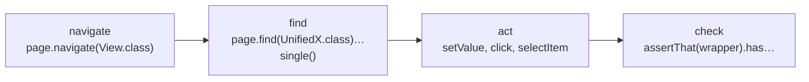

# Developer guide

How to write Unified UI Tests, by example. The [Specification](../spec/README.md) says what the Unified API guarantees and why; this guide shows how to use it.

Most examples below are included from the tests in [`unified-test-demo`](https://github.com/jcgueriaud1/unified-testing-tool/tree/main/unified-test-demo/src/test/java/demo). They run in CI on every Testing Tool, so they can't go out of date.

## Your first test

Add the dependencies as in [Try it](../index.md#try-it). Then:

```java
--8<-- "unified-test-demo/src/test/java/demo/ProfileViewTest.java:savesName"
```

in a class like this:

```java
import static com.vaadin.testing.unified.assertion.UnifiedAssertions.assertThat;

import com.vaadin.testing.unified.UnifiedPage;
import com.vaadin.testing.unified.component.UnifiedButton;
import com.vaadin.testing.unified.component.UnifiedNotification;
import com.vaadin.testing.unified.component.UnifiedTextField;
import com.vaadin.testing.unified.spring.UnifiedSpringBootTest;
import org.junit.jupiter.api.Test;

@UnifiedSpringBootTest          // @UnifiedUITest for an app without Spring Boot
class ProfileViewTest {
    // tests take a UnifiedPage parameter
}
```

Run it:

```
mvn test                                         # Browserless, the default
mvn test -Dvaadin.testing.tool=playwright        # the same test in a real browser
```

!!! tip "Import `assertThat` from `UnifiedAssertions`"
    `UnifiedAssertions.assertThat(wrapper)` retries until the timeout; AssertJ's or JUnit's assertions don't. Import it statically next to your other assertion libraries: it only accepts Unified API types.

## Four steps in every test



| Step | API | Guide page |
|---|---|---|
| Open a view | `page.navigate(View.class)` | [Navigation, users and windows](navigation-and-users.md) |
| Find a component | `page.find(Wrapper.class)`, filters, `single()` / `all()` / `exists()` | [Finding components](finding-components.md) |
| Act on it | the wrapper's methods: `setValue`, `click`, `selectItem`, … | [Working with components](components.md), [Grid](grid.md) |
| Check the result | `assertThat(wrapper)` | [Assertions and waiting](assertions-and-waiting.md) |

Then, when you need more:

- [When a test needs one Testing Tool](tool-specific.md): the Escape Hatch, `@RequiresBrowser`, `@RequiresTestingTool`.
- [Wrappers for your own components](custom-wrappers.md): add-ons, custom components, custom filters.

## Rules of thumb

- **Find components the way a user does:** by type and label, accessible name or text. Use a test id only when there is nothing the user can read.
- **Check state with `assertThat`**, not with getters and `assertEquals`: getters don't retry, and in a browser the update may arrive a moment later.
- **Keep wrappers, not values.** A wrapper finds its component again on every call, so it never goes stale: find a field once, use it for the whole test.
- **Never name a Testing Tool in a test**, unless it needs one ([When a test needs one Testing Tool](tool-specific.md)).
