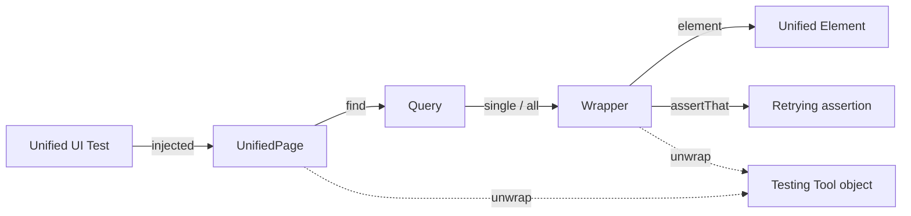

# 1. Concepts

Definitions are in [GLOSSARY.md](../../GLOSSARY.md). This page shows how the terms fit together.

| Term | In one line |
|---|---|
| **Unified API** | The Java API tests are written against. |
| **Testing Tool** | What runs the test: Browserless, Playwright (Dramafinder) or Selenium (TestBench). |
| **Unified UI Test** | A test written only against the Unified API. |
| **Unified Page** | The test's view of one tab or window showing the app. Injected into the test. |
| **Wrapper** | The Unified API object for one component (`UnifiedTextField`, …). Lazy. |
| **Unified Element** | Portable low-level handle under every Wrapper. |
| **Core Set** | The 12 components the spec designs in full. |
| **Auto-Wait** | Every action waits before (component usable) and after (server round-trip). |
| **Capability** | Something a test needs from the Testing Tool, e.g. a real browser. |
| **Escape Hatch** | Typed way out to the Testing Tool's own objects. |

## Design principles

| Principle | Effect | Decided in |
|---|---|---|
| Facade with Escape Hatches | Shared features in the API; the rest via `unwrap` | map, [#10](https://github.com/jcgueriaud1/unified-testing-tool/issues/10) |
| Test what the user sees | Locate by label, accessible name, text | [#7](https://github.com/jcgueriaud1/unified-testing-tool/issues/7) |
| No waits in tests | Auto-Wait and retrying assertions | [#8](https://github.com/jcgueriaud1/unified-testing-tool/issues/8) |
| Wrong code does not compile | Filters per component type | [ADR 0001](../adr/0001-locator-filters-follow-component-type.md) |
| Same behaviour on every tool | Adapters fill each tool's gaps | [#8](https://github.com/jcgueriaud1/unified-testing-tool/issues/8), [#11](https://github.com/jcgueriaud1/unified-testing-tool/issues/11) |
| Add-ons are first-class | Core Set built with the public wrapper mechanism | [ADR 0003](../adr/0003-wrappers-are-interfaces-shipped-in-the-addon-jar.md) |
