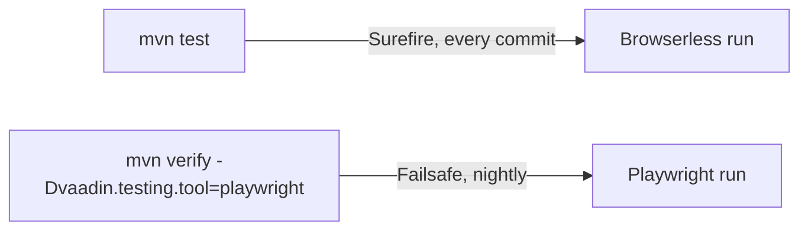

# 2. Test setup

Decided in [#9](https://github.com/jcgueriaud1/unified-testing-tool/issues/9) (choosing the Testing Tool), [#15](https://github.com/jcgueriaud1/unified-testing-tool/issues/15) and [#25](https://github.com/jcgueriaud1/unified-testing-tool/issues/25) (reaching the app), proven in [#24](https://github.com/jcgueriaud1/unified-testing-tool/issues/24).

## Marking a test

| Annotation | Use for |
|---|---|
| `@UnifiedUITest` | Any app. JUnit 6 extension, no base class. |
| `@UnifiedSpringBootTest` | Spring Boot apps. `@SpringBootTest(webEnvironment = RANDOM_PORT)` + `@UnifiedUITest`. |

The extension injects `UnifiedPage` as a test method or constructor parameter.

```java
@UnifiedUITest
class LoginViewTest {
    @Test
    void logsIn(UnifiedPage page) { ... }
}
```

## Choosing the Testing Tool

One Testing Tool per **run**. Test code never names it.

| Setting (JUnit configuration parameter) | Values | Default |
|---|---|---|
| `vaadin.testing.tool` | `browserless`, `playwright`, `selenium` | `browserless` |
| `vaadin.testing.base-url` | URL of the running app (browser Testing Tools) | from the Spring port, else `http://localhost:8080` |
| `vaadin.testing.timeout` | Auto-Wait and assertion timeout | `10s` |

Set them in `src/test/resources/junit-platform.properties` or with `-D` from Maven, Gradle or the IDE.

A build runs the suite once per Testing Tool it wants:



All other settings stay with each tool: browser type, headless mode, Selenium Grid, TestBench license key, Browserless `@ViewPackages`.

## Reaching the application

The Unified API never starts a server itself.

| App | Browserless | Browser Testing Tools |
|---|---|---|
| Spring Boot, `@UnifiedSpringBootTest` | App built in the test JVM from the Spring context (`SpringBrowserlessApplicationContext`) | Same Spring context, random port; base URL `http://localhost:<port>` |
| Plain servlet / other | Views found with Browserless's `@ViewPackages` | Server started by the build (e.g. Failsafe + `jetty:start`); base URL from `vaadin.testing.base-url` |

`@UnifiedSpringBootTest` always uses a random port, also on Browserless runs. Cost: one embedded-server start per cached Spring context, not per test. Benefit: same app setup on every Testing Tool.

```java
@UnifiedSpringBootTest(properties = "app.feature.x=true")
class ProfileViewTest {
    @MockitoBean ProfileService service;   // works on all three: the server runs in the test JVM

    @Test
    void savesName(UnifiedPage page) { ... }
}
```

| Case | Rule |
|---|---|
| Narrow Spring context (`@ContextConfiguration`, no web server) | Browserless only: declare `@RequiresTestingTool(BROWSERLESS)`. Portable alternative: `@UnifiedSpringBootTest` + `@MockitoBean`. |
| Browser runs | Need `com.vaadin:vaadin-dev` (dev mode with the pre-built dev bundle). |
| Quarkus | Not specified yet ([open-questions.md](open-questions.md)). |

## Test data

On Browserless the views run on the test's thread; in a browser they run on the server's request threads.
So a test's transaction doesn't reach the views in a browser:

| `@Transactional` on a `@UnifiedSpringBootTest` | Browserless | Playwright, Selenium |
|---|---|---|
| Views see data the test wrote but didn't commit | yes | no |
| What the views write is rolled back after the test | yes | no, later tests see it |

A `@Transactional` test therefore fails on browser Testing Tools before it starts, with this reason
(`propagation = NOT_SUPPORTED` or `NEVER` is allowed). To isolate test data on every Testing Tool, commit
it, and reset the database after each test: delete what the test created, or restore the tables from a
copy taken once after the context started (with Testcontainers, a fresh schema per test class also works).

## Requirements on Testing Tool adapters

- Read the Testing Tool and timeout only from the JUnit configuration parameters above.
- Browser adapters: own the browser lifecycle; one fresh page per test.
- Browserless adapter: build the app per test, from the Spring context if there is one.
- Close everything after each test.
