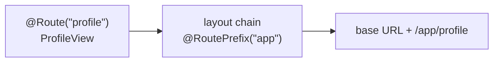

# 3. Navigation

Decided in [#16](https://github.com/jcgueriaud1/unified-testing-tool/issues/16).

```java
page.navigate(ProfileView.class);                              // recommended
page.navigate(OrderView.class, 42L);                           // HasUrlParameter
page.navigate(OrderView.class, new RouteParameters("id", "42"));
page.navigate("profile?tab=2");                                // path, relative to the base URL
page.reload();

assertThat(page).isAt(ProfileView.class);
assertThat(page).hasPath("profile").hasQueryParameter("tab", "2");
```

| Rule | Detail |
|---|---|
| Two forms | Route class (refactor-safe, recommended) or path. Path form covers query strings and routes registered at runtime. |
| Relative only | Paths are relative to the base URL. Absolute or external URLs need `@RequiresBrowser`. |
| Returns nothing | Auto-Waits until the view is shown and the server is idle. The view instance is available only via the Escape Hatch (Browserless). |
| Flow types | Route classes, `RouteParameters`, `QueryParameters` from `flow-server`. |
| Reload | `page.reload()` on every Testing Tool (Browserless simulates it, `@PreserveOnRefresh` respected). |
| Back / forward | Escape Hatch only. |

## Route class to URL (browser Testing Tools)

Resolved **statically** from annotations, without the running app's router:



Routes registered at runtime (`RouteConfiguration`) use the path form.

## Requirements on Testing Tool adapters

- Resolve route classes from `@Route` and parent layouts' `@RoutePrefix`, plus route and URL parameters.
- After navigation, wait for the target view and an idle server.
- Location assertions retry until the timeout.
