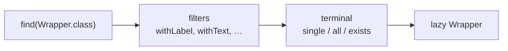

# 4. Locating components

Decided in [#7](https://github.com/jcgueriaud1/unified-testing-tool/issues/7) and [#12](https://github.com/jcgueriaud1/unified-testing-tool/issues/12); see [ADR 0001](../adr/0001-locator-filters-follow-component-type.md) and [ADR 0002](../adr/0002-unified-wrapper-names-and-class-literal-lookups.md).

## Query shape

```java
UnifiedTextField name = page.find(UnifiedTextField.class).withLabel("Name").single();
```



- The wrapper type acts as the role (like Playwright's `getByRole`). No role filter.
- Each wrapper declares its query type (`UnifiedTextField extends Findable<TextFieldQuery>`), so `find` returns a query with **only the filters that make sense for that type**. Wrong filters do not compile:

```java
page.find(UnifiedButton.class).withLabel("Save");   // compile error: Button has no label
page.find(UnifiedButton.class).withText("Save");    // OK
```

## Filters

Exact match by default (whitespace normalised); every text filter has a `…Containing` variant, which matches a case-insensitive substring.

| Filter | Matches | On | Recommended |
|---|---|---|---|
| `withLabel` | `label` property, a `<label for>`, or the FormLayout item label | types with a label | yes |
| `withAccessibleName` | what a screen reader announces (see below) | every type | yes |
| `withText` | text content: `getText()`, the DOM text, the same on every Testing Tool | types with text | yes |
| `withPlaceholder` | `placeholder` | fields | yes |
| `withTestId` | `data-testid` (`Component.setTestId`) | every type | fallback |
| `withId` | `id` | every type | fallback |
| `withClassName`, `withTheme`, `withAttribute` | CSS class, theme, attribute | every type | no (implementation details) |
| `visible()` | visible components only (`isVisible()`) | every type | where visibility matters |
| `withProperty`, `where(Predicate<UnifiedElement>)` | building blocks for custom filters | every type | for wrapper authors |
| type-specific, e.g. `withHeaderTitle` | declared by the wrapper's query | that type | yes |

**Accessible name** order on every Testing Tool (Dramafinder's own filters use the browser's computation):

1. `aria-label`
2. the `accessibleName` property (what `setAriaLabel` sets on a field; the field forwards it to its input)
3. text of the `aria-labelledby` target
4. `label`
5. text content (buttons)

Rare edge cases can differ from the browser.

## What a query sees

The same on every Testing Tool:

| Rule | Detail |
|---|---|
| Hidden components | **included**: a component hidden after it was shown stays in a browser's page, so Browserless includes it too. Add `.visible()` for "the action is gone". A component that was never visible is in no browser's page (Flow doesn't send it), but Browserless finds it: `.visible()` gives the same answer everywhere. |
| Dialogs, notifications | open ones only; a closed dialog (the app's or the dev tools') is not part of the page |
| Shadow DOM | not searched, except the shadow DOM of the app's own templates in Playwright; Vaadin's components and the dev tools are left out |
| Grid cell components | found page-wide for the rows the grid rendered, as a browser has them |
| No tag | a query for a component without a tag (`findComponent(Component.class)`, a `Composite`) fails at once on every Testing Tool: a browser can't find it |

Browser adapters put the filters CSS can express (id, test id, class, theme, attribute) into the selector and check the others in the page, for every candidate in one call.

**Guidance:** locate by what the user sees (type + label, accessible name or text). Use test id or id only when a component has no user-visible name.

## Terminals

| Terminal | Result |
|---|---|
| `single()` | Lazy wrapper; exactly one match when first used |
| `all()` | List of lazy wrappers |
| `exists()` | `boolean` |

No `first()` and no index terminal: use `all().get(i)`.

## Scoping

Every wrapper that is a `Scope` (page, `UnifiedDialog`, `UnifiedContainer`) can start a query:

```java
UnifiedDialog dialog = page.find(UnifiedDialog.class).withHeaderTitle("Delete account?").single();
dialog.find(UnifiedButton.class).withText("Delete").single().click();

var address = page.find(UnifiedContainer.class).withTestId("address-form").single();  // layouts
address.find(UnifiedTextField.class).withLabel("City").single().setValue("Turku");
```

Components created by renderers (e.g. Grid cells) and the content of closed overlays are reached through their **owning wrapper** on every Testing Tool ([07-grid.md](07-grid.md)).

## Components without a wrapper

```java
var rating = page.findComponent(Rating.class).withLabel("Score").single();   // tag from @Tag
```

## Escape Hatch only

CSS, XPath, ARIA role queries, predicates over a tool's own objects ([08-escape-hatch.md](08-escape-hatch.md)).

## Requirements on Testing Tool adapters

| Adapter | Maps the wrapper type to |
|---|---|
| Browserless | the Flow component class |
| Playwright | a locator from the web component tag |
| Selenium | the web component tag |

- Implement every filter in the table with the same meaning; exact match by default.
- `single()` fails when zero or several components match, when the wrapper is first used.
- TestBench before 25.4: implement `withTestId` with the `data-testid` attribute.
