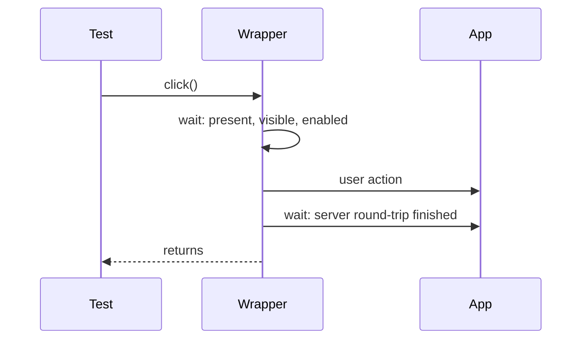

# 5. Waiting

Decided in [#8](https://github.com/jcgueriaud1/unified-testing-tool/issues/8). Term: **Auto-Wait**.

## Auto-Wait

Every action (`click`, `setValue`, `navigate`, …) on every Testing Tool:



| Testing Tool | Before the action | After the action |
|---|---|---|
| Browserless | by construction | by construction (synchronous) |
| Playwright (Dramafinder) | Playwright actionability | **adapter adds** wait for Vaadin idle |
| Selenium (TestBench) | **adapter adds** element-state wait | `waitForVaadin` |

## Lazy wrappers

`single()` returns a wrapper that finds its component again on every action or assertion. It waits for components that appear later and never goes stale.

## Assertions and getters

| | Retries | Use |
|---|---|---|
| `assertThat(wrapper).hasValue("x")` | yes, until the timeout; failure shows expected and actual | checking state (recommended) |
| `wrapper.getValue()` | no (read after the round-trip) | reading a value to use it |

```java
assertThat(name).hasValue("Alice").isValid();          // good
assertEquals("Alice", name.getValue());                 // flaky in a browser after async updates
```

## Background work

On Browserless, retrying assertions and waits run `roundTrip()` and `runPendingSignalsTasks()` between attempts, so views updated from background threads (`UI.access`, signals) behave the same as in a browser.

## Timeouts and generic waits

- One default timeout, `10s`, set with `vaadin.testing.timeout`.
- Per call: `wrapper.withTimeout(Duration.ofSeconds(30))`.
- Any other condition: `page.waitUntil(() -> …)`, same timeout and Browserless flushing.

## Turning Auto-Wait off

Not part of the Unified API. Use the Escape Hatch and the tool's own switch (e.g. TestBench `disableWaitForVaadin()`). Not possible on Browserless.

## Requirements on Testing Tool adapters

- Guarantee both halves of Auto-Wait for every action.
- Re-resolve wrappers on every call.
- Retry assertions until the timeout; on Browserless flush `UI.access` tasks and signals between attempts.
