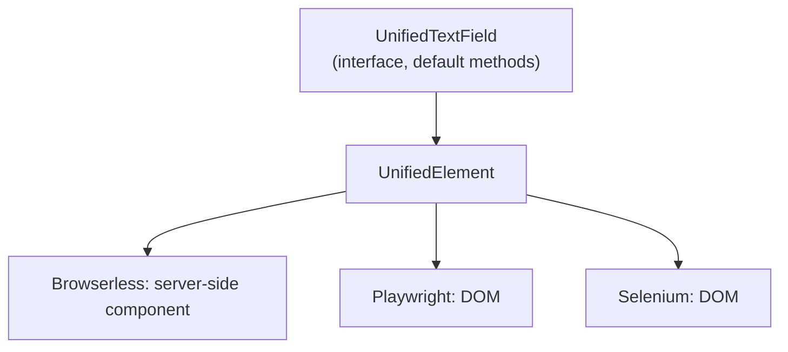

# 6. Wrappers

Decided in [#6](https://github.com/jcgueriaud1/unified-testing-tool/issues/6) (Core Set), [#12](https://github.com/jcgueriaud1/unified-testing-tool/issues/12) (wrapper shape) and [#18](https://github.com/jcgueriaud1/unified-testing-tool/issues/18) (custom and add-on wrappers); see [ADR 0002](../adr/0002-unified-wrapper-names-and-class-literal-lookups.md) and [ADR 0003](../adr/0003-wrappers-are-interfaces-shipped-in-the-addon-jar.md).

## Core Set

One component per interaction pattern. Every other component follows the same pattern.

| Pattern | Wrapper | Status |
|---|---|---|
| Text value | `UnifiedTextField` (TextArea, PasswordField, EmailField follow) | in the sketch |
| Typed value | `UnifiedNumberField`, `UnifiedDatePicker` | pattern only |
| Boolean value | `UnifiedCheckbox` | pattern only |
| Single selection | `UnifiedComboBox`, `UnifiedRadioButtonGroup` | pattern only |
| Multi selection | `UnifiedMultiSelectComboBox` | pattern only |
| Action | `UnifiedButton` | in the sketch |
| Overlays | `UnifiedDialog`, `UnifiedNotification` | in the sketch |
| Data | `UnifiedGrid` | in the sketch: [07-grid.md](07-grid.md) |
| Navigation | `UnifiedTabSheet` | pattern only |
| (layouts, for scoping) | `UnifiedContainer` | in the sketch |

Rules: a Core Set component is supported by all three Testing Tools; no commercial components (Grid Pro, Charts, Spreadsheet, Board, Crud); no layouts.

## Naming

Prefix `Unified`. The plain and suffixed names are taken by classes a test may import at the same time:

| Name | Taken by |
|---|---|
| `TextField` | Flow component |
| `TextFieldElement` | Dramafinder **and** TestBench |
| `TextFieldTester`, `TextFieldLocator` | Browserless |

## Shape



A wrapper is an **interface with default methods** over `element()`. The Unified API implements it at runtime. Authors write no implementation class.

```java
@UnifiedComponent(TextField.class)
public interface UnifiedTextField extends UnifiedWrapper, Findable<UnifiedTextField.TextFieldQuery> {

    interface TextFieldQuery extends Query<UnifiedTextField, TextFieldQuery>,
            LabelFilter<TextFieldQuery>, PlaceholderFilter<TextFieldQuery> {}

    default void setValue(String value) { element().setValueAsUser(value); }          // action, Auto-Wait
    default String getValue() { return element().getProperty("value"); }             // getter, immediate
    default boolean isInvalid() { return Boolean.TRUE.equals(element().getPropertyBoolean("invalid")); }
}
```

| Part | Rule |
|---|---|
| Actions | Auto-Wait (`setValue`, `clear`, `click`, …) |
| Getters | Immediate, no retry |
| Assertions | Static `assertThat(wrapper)` in `UnifiedAssertions`, retrying |
| Every wrapper | `element()`, `unwrap`, `tryUnwrap`, `withTimeout`, `isVisible`, `isEnabled` |
| Scopes | `UnifiedDialog`, `UnifiedContainer` also have `find` |

## Unified Element

The portable layer every wrapper is written on:

| Group | Operations |
|---|---|
| Read | `getTag`, `getText`, `getProperty…`, `getAttribute`, `isVisible`, `isEnabled`, `getCssValue` (browser only) |
| Write | `setProperty` |
| User actions (Auto-Wait) | `click`, `setValueAsUser`, `focus`, `blur`, `pressKey`, `dispatchEvent` |
| Structure | `findChildren(tag)` |

Browserless acts on the server-side element and component, firing events as from the browser. Browser Testing Tools act on the DOM. **Limitation:** on Browserless a property is the server-side value; it equals the browser value only for properties Flow synchronises.

## Custom and add-on components

### Identifying the component

`@UnifiedComponent(Rating.class)`: the Flow class for Browserless; the tag for browsers is read from its `@Tag`. Add `tag = "…"` only for `Composite`-based components.

### Per-tool overrides

When the Unified Element is not enough (canvas, overlays, renderer content on Browserless):

```java
@UnifiedComponent(value = Rating.class,
        overrides = @ToolImplementation(tool = TestingTool.BROWSERLESS, value = RatingBrowserless.class))
public interface UnifiedRating extends UnifiedWrapper, Findable<RatingQuery> { ... }
```

`RatingBrowserless` implements the interface with Browserless's own API via the Escape Hatch.

### Custom filters

Default methods on the query, built from `withProperty`, `withAttribute` or `where(Predicate<UnifiedElement>)`:

```java
interface RatingQuery extends Query<UnifiedRating, RatingQuery>, LabelFilter<RatingQuery> {
    default RatingQuery withRating(int value) { return withProperty("value", value); }
}
```

### Three ways to test an add-on

| Effort | How | When |
|---|---|---|
| none | `page.findComponent(Rating.class)`: shared filters + Unified Element | any add-on, today |
| low (recommended) | wrapper interface **in the add-on's own jar**, Unified API as `optional` dependency | add-on authors; works with single-module Vaadin Directory add-ons |
| shared | community bundle (e.g. `unified-addons`) | popular add-ons without their own wrapper |

The Core Set is built with this same mechanism, with overrides where needed.

## Requirements on Testing Tool adapters

- Implement every Unified Element operation with the same meaning.
- Implement wrapper and query interfaces at runtime (`InvocationHandler.invokeDefault`) and honour `@ToolImplementation` overrides.
- Read the tag from `@Tag` unless `@UnifiedComponent.tag` is set.
