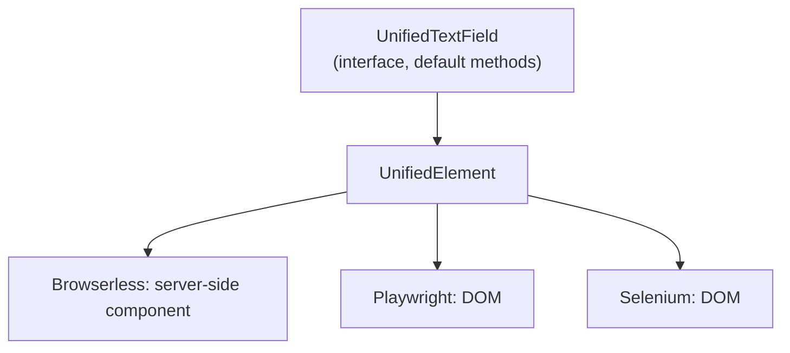

# 6. Wrappers

Decided in [#6](https://github.com/jcgueriaud1/unified-testing-tool/issues/6) (Core Set), [#12](https://github.com/jcgueriaud1/unified-testing-tool/issues/12) (wrapper shape) and [#18](https://github.com/jcgueriaud1/unified-testing-tool/issues/18) (custom and add-on wrappers); see [ADR 0002](../adr/0002-unified-wrapper-names-and-class-literal-lookups.md) and [ADR 0003](../adr/0003-wrappers-are-interfaces-shipped-in-the-addon-jar.md).

## Core Set

One component per interaction pattern. Every other component follows the same pattern.

| Pattern | Wrapper | Status |
|---|---|---|
| Text value | `UnifiedTextField`, `UnifiedTextArea` (PasswordField, EmailField follow) | implemented |
| Typed value | `UnifiedNumberField`, `UnifiedIntegerField`, `UnifiedBigDecimalField`, `UnifiedDatePicker`, `UnifiedDateTimePicker` | implemented; `UnifiedDatePicker.typeText(..)` and `UnifiedDateTimePicker.typeText(date, time)` type unparsed text |
| Boolean value | `UnifiedCheckbox` | implemented |
| Single selection | `UnifiedComboBox`, `UnifiedRadioButtonGroup` | implemented |
| Multi selection | `UnifiedMultiSelectComboBox` | implemented |
| Action | `UnifiedButton`, `UnifiedMenuBar` | implemented: `clickItem("File", "Export", "PDF")` opens the menus as a user does; items by Item Name (an icon-only item by its `aria-label`); `isItemEnabled(..)` |
| Overlays | `UnifiedDialog`, `UnifiedNotification` | implemented |
| Disclosure | `UnifiedDetails` | implemented: `open()`, `close()`, `content()` Scope |
| Files | `UnifiedUpload` | implemented: `upload(name, type, bytes)` waits until the server has the file |
| Data | `UnifiedGrid` | in the sketch: [07-grid.md](07-grid.md) |
| Navigation | `UnifiedTabSheet`, `UnifiedTabs` | implemented: `selectTab(name)`, `getSelectedTab()`; a tab's name is its Item Name (the text of a tab holding a `RouterLink`); a TabSheet's `content()` Scope follows the selected tab |
| (layouts, for scoping) | `UnifiedContainer` | implemented: any component, found by test id or id |
| (plain HTML, for scoping and text) | `UnifiedDiv`, `UnifiedSpan`, `UnifiedParagraph`, `UnifiedSection`, `UnifiedNav`, `UnifiedHeader`, `UnifiedFooter`, `UnifiedMain`, `UnifiedArticle`, `UnifiedAside` | implemented: bound to their tag, so one browser query; Scopes |

Input fields share `UnifiedField` (label, helper text, validation getters). Typed values are Java types: `Double` for a NumberField, `Integer`, `BigDecimal` (compare with `compareTo`: the scale is what the user typed), `LocalDate` for a DatePicker, `LocalDateTime` for a DateTimePicker, `null` when empty. Selection fields identify items by the label the user sees (the item label generator's result): `selectItem("Germany")`, `getSelectedItem()`, `getItems()`. A select fails when the item doesn't exist (listing the items) or isn't selected afterwards. In a browser, a combo box's `getItems()` returns the items its drop-down loads at once (first page, 50 by default).

Rules: a Core Set component is supported by all three Testing Tools; no commercial components (Grid Pro, Charts, Spreadsheet, Board, Crud); no layouts.

## Naming

Prefix `Unified`. The plain and suffixed names are taken by classes a test may import at the same time:

| Name | Taken by |
|---|---|
| `TextField` | Flow component |
| `TextFieldElement` | Dramafinder **and** TestBench |
| `TextFieldTester`, `TextFieldLocator` | Browserless |

## Shape



A wrapper is an **interface with default methods** over `element()`. The Unified API implements it at runtime. Authors write no implementation class.

```java
@UnifiedComponent(TextField.class)
public interface UnifiedTextField extends UnifiedWrapper, Findable<UnifiedTextField.TextFieldQuery> {

    interface TextFieldQuery extends Query<UnifiedTextField, TextFieldQuery>,
            LabelFilter<TextFieldQuery>, PlaceholderFilter<TextFieldQuery> {}

    default void setValue(String value) { element().setValueAsUser(value); }          // action, Auto-Wait
    default String getValue() { return element().getProperty("value"); }             // getter, immediate
    default boolean isInvalid() { return Boolean.TRUE.equals(element().getPropertyBoolean("invalid")); }
}
```

| Part | Rule |
|---|---|
| Actions | Auto-Wait (`setValue`, `clear`, `click`, …) |
| Getters | Immediate, no retry |
| Assertions | Static `assertThat(wrapper)` in `UnifiedAssertions`, retrying |
| Every wrapper | `element()`, `unwrap`, `tryUnwrap`, `withTimeout`, `isVisible`, `isEnabled` |
| Scopes | `UnifiedDialog`, `UnifiedDetails`, `UnifiedContainer`, the plain HTML wrappers and any `findComponent(..)` result also have `find` |

## Unified Element

The portable layer every wrapper is written on:

| Group | Operations |
|---|---|
| Read | `getTag`, `getText`, `getProperty…`, `getAttribute`, `getInlineStyle`, `isVisible`, `isEnabled`, `getVisibleText` and `getCssValue` (browser only) |
| Write | `setProperty` |
| User actions (Auto-Wait) | `click`, `setValueAsUser`, `focus`, `blur`, `pressKey`, `dispatchEvent` |
| Structure | `findChildren(tag)`, `children()`, `findDescendants(tag)` |

| Operation | Meaning on every Testing Tool |
|---|---|
| `getText()` | the DOM text (`textContent`), whitespace collapsed and trimmed. CSS doesn't change it: `text-transform`, hidden descendants and line breaks between flex items don't count. Browserless reads the same text from the server-side elements. |
| `getVisibleText()` | the text as rendered (`innerText`); browser only |
| `getInlineStyle(name)` | the value the inline style declares, as written (`var(--gap)`), or null |
| `findChildren(tag)` | direct light-DOM children with this tag (`*`: any), in order; text nodes don't count; never a web component's shadow DOM. `children()` is `findChildren("*")`. |
| `findDescendants(tag)` | every light-DOM element below, in document order. Web components add light DOM of their own in a browser (a text field's input and label), which Browserless doesn't have. |
| `setValueAsUser` on a native `<input>` | sets the value and fires `input` and `change`, for Flow's `Input` and a bare `Element("input")` |

Browserless acts on the server-side element and component, firing events as from the browser. Browser Testing Tools act on the DOM. **Limitation:** on Browserless a property is the server-side value; it equals the browser value only for properties Flow synchronises.

## Custom and add-on components

### Identifying the component

`@UnifiedComponent(Rating.class)`: the Flow class for Browserless; the tag for browsers is read from its `@Tag`. Add `tag = "…"` only for `Composite`-based components.

A component built from a common one (`MetricCard extends VerticalLayout`) has that one's tag: a browser can't tell it apart by class. `selector` adds what tells it apart, applied by every Testing Tool:

```java
@UnifiedComponent(value = MetricCard.class, selector = ".metric-card")
public interface UnifiedMetricCard extends UnifiedWrapper, Findable<MetricCardQuery> { … }
```

`selector` is a compound CSS selector of `.class`, `#id`, `[attribute="value"]` and `[theme~="value"]`, without spaces. Wrapper interfaces must be public, and so must the classes they are nested in.

### Per-tool overrides

When the Unified Element is not enough (canvas, overlays, content written by client-side JavaScript, which Browserless doesn't run):

```java
@UnifiedComponent(value = Badge.class,
        overrides = @ToolImplementation(tool = TestingTool.BROWSERLESS, value = UnifiedBadgeBrowserless.class))
public interface UnifiedBadge extends UnifiedWrapper, Findable<BadgeQuery> {
    default int getCount() { return Integer.parseInt(element().getText().split(" ")[0]); }  // "3 new"
}

public interface UnifiedBadgeBrowserless extends UnifiedBadge {
    @Override
    default int getCount() { return unwrap(Badge.class).getCount(); }   // Escape Hatch: the Java component
}
```

| Rule | Detail |
|---|---|
| Shape | an **interface extending the wrapper**; it redefines only the methods that need the tool's own API, the rest is inherited |
| When used | on that Testing Tool, the wrapper returned by `find(..)` implements the override (`instanceof UnifiedBadgeBrowserless`) |
| Wrong shape | a class, or an interface not extending the wrapper: fails at the first `find(..)` with a message |

Implemented; demo: `demo.addon` (component) and `demo.addon.testing` (wrappers, in the main jar).

### Custom filters

Default methods on the query, built from `withProperty`, `withAttribute` or `where(Predicate<UnifiedElement>)`:

```java
interface RatingQuery extends Query<UnifiedRating, RatingQuery>, LabelFilter<RatingQuery> {
    default RatingQuery withRating(int value) { return withProperty("value", value); }
}
```

### Three ways to test an add-on

| Effort | How | When |
|---|---|---|
| none | `page.findComponent(Rating.class)`: shared filters + Unified Element | any add-on, today |
| low (recommended) | wrapper interface **in the add-on's own jar**, Unified API as `optional` dependency | add-on authors; works with single-module Vaadin Directory add-ons |
| shared | community bundle (e.g. `unified-addons`) | popular add-ons without their own wrapper |

The Core Set is built with this same mechanism, with overrides where needed.

## Requirements on Testing Tool adapters

- Implement every Unified Element operation with the same meaning.
- Implement wrapper and query interfaces at runtime (`InvocationHandler.invokeDefault`) and honour `@ToolImplementation` overrides.
- Read the tag from `@Tag` unless `@UnifiedComponent.tag` is set.
