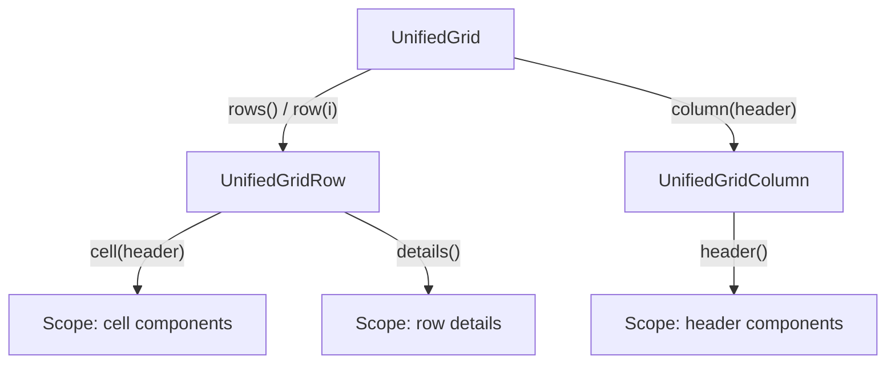

# 7. Grid

Decided in [#28](https://github.com/jcgueriaud1/unified-testing-tool/issues/28), from the prototype on branch [`prototype/grid-wrapper`](https://github.com/jcgueriaud1/unified-testing-tool/tree/prototype/grid-wrapper/prototypes/grid-wrapper). Sketch: [`UnifiedGrid`](../../spec/api-sketch/src/main/java/com/vaadin/testing/unified/component/UnifiedGrid.java), example [`UsersViewTest`](../../spec/api-sketch/src/test/java/example/UsersViewTest.java).

## Shape

Rows are found by **what they show**. Index access stays for tests where order is the point.

```java
UnifiedGrid users = page.find(UnifiedGrid.class).withAccessibleName("Users").single();

users.column("Name").header().find(UnifiedTextField.class).single().setValue("Ali");   // header filter
assertThat(users).hasRowCount(1);

var alice = users.rows().withCellText("Name", "Alice").single();
assertThat(alice).hasCellText("Email", "alice@example.com");
alice.cell("Actions").find(UnifiedButton.class).withText("Edit").single().click();   // component in a cell

alice.select();
alice.toggleDetails();
alice.details().find(UnifiedButton.class).withText("Reset password").single().click();

users.column("Name").sort(SortDirection.ASCENDING);
assertThat(users.column("Name")).isSortedAscending().hasCellTexts("Alice", "Bob", "Carol");
assertThat(users.row(0)).hasCellText("Name", "Alice");
```



## API

| Object | Members |
|---|---|
| `UnifiedGrid` | `rows()`, `row(i)`, `getRowCount()`, `column(header)`, `columnWithId(id)`, `column(index)`, `getColumnHeaders()`, `selectAll()`, `deselectAll()` |
| `RowQuery` | `withCellText(column, text)`, `withCellTextContaining(..)`, `selected()`, `single()`, `all()`, `exists()` |
| `UnifiedGridRow` | `getIndex()`, `getCellText(column)`, `cell(column)` (Scope), `select()`, `deselect()`, `isSelected()`, `click()`, `doubleClick()`, `toggleDetails()`, `details()` (Scope) |
| `UnifiedGridColumn` | `header()` (Scope), `sort(direction)`, `getSortDirection()`, `getCellTexts()` |

| Retrying assertion | On |
|---|---|
| `hasRowCount(n)`, `isEmpty()` | grid |
| `isSelected()`, `isNotSelected()`, `hasCellText(column, text)`, `hasDetailsOpen()` | row |
| `hasCellTexts(…)`, `isSortedAscending()`, `isSortedDescending()` | column |

## Rules

| Rule | Detail |
|---|---|
| Columns | By header text (recommended); `columnWithId(id)` for columns without header text (`Column.setId`, sent to the browser as the column element's id); `column(index)` among visible columns in display order as a last resort. **No lookup by key:** `Column.setKey` stays on the server, so no browser Testing Tool can see it. |
| Values | Rendered text only. The item behind a row: Escape Hatch (Browserless). |
| Lazy loading | Row access scrolls the row into view and waits for its data (Auto-Wait). `getRowCount()` is the total, not the rendered rows. |
| Cell components | Through `row.cell(column)` on every Testing Tool (Browserless queries can't see renderer components). |
| Selection | Single and multi; `selectAll` / `deselectAll`. |

## Not in this version

TreeGrid, column reordering, Grid context menu, Grid Pro editing, drag and drop: listed in [open-questions.md](open-questions.md); they follow the same pattern later.

## Requirements on Testing Tool adapters

| Adapter | Implements Grid with |
|---|---|
| Browserless | `GridTester` (`getCellText`, `getCellComponent`, `select`, `sortByColumn`, …) |
| Playwright | Dramafinder `GridElement` (`findRowIndexesWithColumnText`, `getCell`, `waitForGridToStopLoading`, …) |
| Selenium | TestBench `GridElement` (`getCell`, `scrollToRow`, `select`, …) |

- Scroll and wait for data before any row access.
- Resolve column header text the same way on every tool.
