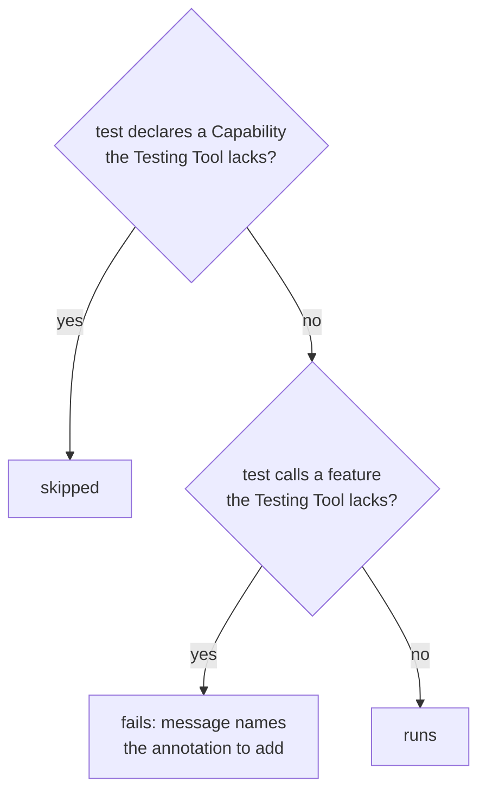

# 9. Capabilities and limitations

Decided in [#11](https://github.com/jcgueriaud1/unified-testing-tool/issues/11) and [#9](https://github.com/jcgueriaud1/unified-testing-tool/issues/9).

## Capabilities

| Annotation | Means | Missing on |
|---|---|---|
| `@RequiresBrowser` | real browser: CSS, layout, client JS, real focus and keyboard, screenshots | Browserless |
| `@RequiresTestingTool(X)` | uses a tool-specific Escape Hatch | every tool except X |



Handled at **runtime**, not compile time, so tests stay written once.

## Browser-only features in the Unified API

Each needs `@RequiresBrowser`:

```java
@Test
@RequiresBrowser
void looksRight(UnifiedPage page) {
    assertThat(saveButton).hasCssValue("cursor", "pointer");
    page.screenshot(Path.of("target/profile.png"));
}
```

Network interception, tracing and browser contexts: Escape Hatch only.

## Keyboard

`pressKey` works on every Testing Tool. On Browserless keyboard and focus are simulated. Tests that depend on real browser focus behaviour declare `@RequiresBrowser`.

## Limitations

| | Playwright (Dramafinder) | Selenium (TestBench) | Browserless |
|---|---|---|---|
| CSS, layout, client JS, screenshots | ✓ | ✓ | ✗ (text snapshot of the component tree) |
| Real keyboard and focus | ✓ | ✓ | simulated |
| "Visible" means | rendered | rendered | server-side `setVisible`; CSS-hidden counts as visible |
| Property values | browser | browser | server-side; equal only for synchronised properties |
| Server-side Java state | ✗ | ✗ | ✓ (Escape Hatch) |
| Network interception, tracing | ✓ (Escape Hatch) | ✗ | ✗ |
| External URLs | ✓ | ✓ | ✗ |
| Back / forward history | Escape Hatch | Escape Hatch | ✗ |

Differences in meaning are documented, not banned. Tests that depend on the browser meaning declare `@RequiresBrowser`.

## Failure evidence

| Testing Tool | Captured automatically on failure |
|---|---|
| Playwright, Selenium | screenshot |
| Browserless | component tree dump (`TreeOnFailureExtension`) |

## Requirements on Testing Tool adapters

- Report missing Capabilities as skipped tests.
- Unsupported calls without the annotation fail with a message naming it.
- Capture failure evidence as in the table.
