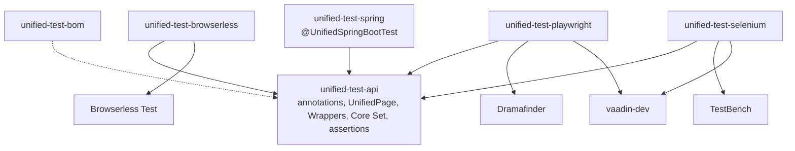

# 10. Packaging

Decided in [#29](https://github.com/jcgueriaud1/unified-testing-tool/issues/29). Inputs from [#10](https://github.com/jcgueriaud1/unified-testing-tool/issues/10), [#16](https://github.com/jcgueriaud1/unified-testing-tool/issues/16), [#24](https://github.com/jcgueriaud1/unified-testing-tool/issues/24), [#25](https://github.com/jcgueriaud1/unified-testing-tool/issues/25) and [ADR 0003](../adr/0003-wrappers-are-interfaces-shipped-in-the-addon-jar.md).

## Artifacts



| Artifact (`com.vaadin`) | Contains | Depends on | License |
|---|---|---|---|
| `unified-test-api` | annotations, `UnifiedPage`, Unified Element, Core Set wrapper interfaces, `UnifiedAssertions` | `flow-server`, JUnit 6 API | Apache-2.0 |
| `unified-test-browserless` | Browserless adapter + its Core Set overrides | Browserless Test | Apache-2.0 |
| `unified-test-playwright` | Playwright adapter + its Core Set overrides | Dramafinder, `vaadin-dev` | Apache-2.0 |
| `unified-test-selenium` | Selenium adapter + its Core Set overrides | TestBench, `vaadin-dev` | Apache-2.0 code; TestBench core is **Vaadin Commercial** |
| `unified-test-spring` | `@UnifiedSpringBootTest` | Spring Boot test | Apache-2.0 |
| `unified-test-bom` | versions of all of the above and of the Testing Tools | | Apache-2.0 |

Packages: `com.vaadin.testing.unified…`.

## Using it

Add the adapters a build uses as test dependencies. No Maven profiles: the run's `vaadin.testing.tool` picks one.

```xml
<dependencyManagement>
  <dependency>
    <groupId>com.vaadin</groupId><artifactId>unified-test-bom</artifactId>
    <version>${vaadin.version}</version><type>pom</type><scope>import</scope>
  </dependency>
</dependencyManagement>

<dependency><groupId>com.vaadin</groupId><artifactId>unified-test-spring</artifactId><scope>test</scope></dependency>
<dependency><groupId>com.vaadin</groupId><artifactId>unified-test-browserless</artifactId><scope>test</scope></dependency>
<dependency><groupId>com.vaadin</groupId><artifactId>unified-test-playwright</artifactId><scope>test</scope></dependency>
```

| Run | Needs |
|---|---|
| Browserless | `unified-test-browserless` |
| Playwright | `unified-test-playwright`, a Chromium/Firefox/WebKit install |
| Selenium | `unified-test-selenium`, a TestBench subscription key |

## Rules

| Rule | Detail |
|---|---|
| Adapter discovery | `ServiceLoader`, keyed by `vaadin.testing.tool`. A missing adapter fails with a message naming the artifact to add. |
| Unused adapters | Never loaded. A Browserless run with `unified-test-selenium` on the classpath does not touch TestBench. |
| Core Set overrides | Live inside each adapter, registered by the adapter. `unified-test-api` never depends on adapter classes. |
| Add-on overrides | `@ToolImplementation` in the add-on's own jar ([06-wrappers.md](06-wrappers.md)). |
| Versioning | Follows Vaadin: one release line per Vaadin minor (`25.3.x`). The BOM pins matching Dramafinder, Browserless Test and TestBench versions. |
| Baseline | Java 21, Vaadin 25, JUnit 6, Spring Boot 4. |

## Community bundle

`unified-addons`, wrappers for popular add-ons whose authors ship none: a separate **community** repository (for example under the `parttio` organisation, next to Dramafinder), with its own release cycle.

## Requirements on Testing Tool adapters

- Register through `ServiceLoader` under their `TestingTool` value.
- Register their Core Set overrides themselves.
- Load nothing of their Testing Tool unless selected for the run.
