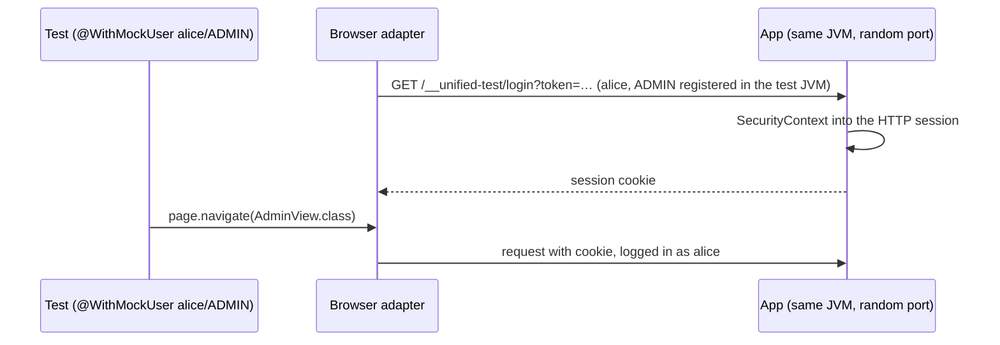

# 11. Users and windows

Decided in [#34](https://github.com/jcgueriaud1/unified-testing-tool/issues/34).

## Running as a user

Spring Security's own `@WithMockUser` (and `@WithUserDetails`) on the test method or class:

```java
@UnifiedSpringBootTest
class AdminViewTest {
    @Test
    @WithMockUser(username = "alice", roles = "ADMIN")
    void adminSeesSettings(UnifiedPage page) {
        page.navigate(AdminView.class);
        assertThat(page).isAt(AdminView.class);
    }
}
```

| Testing Tool | How the adapter logs in |
|---|---|
| Browserless | `SpringBrowserlessApplicationContext.createSecured(..)`, then `newUser(username, roles…)` |
| Playwright, Selenium | Opens a **test-only login endpoint** once before the test; it puts the user into the HTTP session. The endpoint is the Unified API's own (`unified-test-spring`, `TestLogin`): Dramafinder 2.0.1's login is only usable by extending `SpringPlaywrightIT` ([parttio/dramafinder#236](https://github.com/parttio/dramafinder/issues/236)) and Selenium needs it too |



The endpoint exists only in `@UnifiedSpringBootTest` test contexts: `unified-test-spring` is a test dependency and never ships with the application.

**Testing the login itself:** no annotation; navigate to the login view and use the form like any other view.

**Logout:** no API. Use the application's logout, or open another user.

## Several windows and users

`UnifiedPage` is **one window of one user**. More come from the page:

```java
UnifiedPage second = page.openWindow();             // same user, same session
UnifiedPage bob = page.openAsUser("bob", "USER");   // another user, own session
```

| Call | Browserless | Playwright, Selenium |
|---|---|---|
| `openWindow()` | `user.newWindow()` | new page in the same browser context |
| `openAsUser(name, roles…)` | `app.newUser(name, roles…)` | new browser context, logged in through the endpoint |

All windows and users close at the end of the test.

## Implementation status

| | Browserless | Playwright | Selenium |
|---|---|---|---|
| `@WithMockUser`, `@WithUserDetails` (method, class, `@Nested`) | done: Spring's test listener sets the user, the adapter passes it to `createSecured(..).newUser(auth)` | done: login endpoint before the test body | done: login endpoint before the test body |
| `openWindow()` | done | done (page in the same context) | done (tab in the same browser) |
| `openAsUser(..)` | done | done (new browser context, logged in) | done (new browser, logged in) |
| Redirects (anonymous → login view, missing role → access denied) | asserted like any navigation | same | same |

## Not specified

Authentication without Spring Security: left to implementation (the application's real login, or the Escape Hatch). See [open-questions.md](open-questions.md).

## Requirements on Testing Tool adapters

- Read `@WithMockUser` / `@WithUserDetails` from the test method, then the class.
- Browser adapters: log in through the test-only endpoint before the test body runs.
- `openWindow` shares the user's session; `openAsUser` never does.
