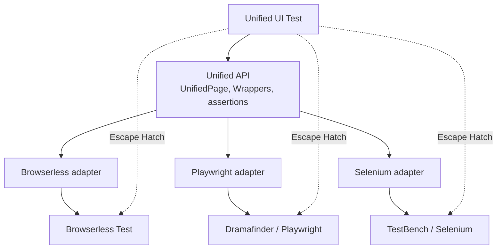

# Unified API for Vaadin UI tests: specification

**Status:** draft, built from the decisions on the map [Unified testing API for Vaadin](https://github.com/jcgueriaud1/unified-testing-tool/issues/2). Not yet handed off (hand-off is tag `spec-v1`).

## Summary

Write a Vaadin Flow UI test **once**, run it on **any** of three Testing Tools, chosen per run:

| Testing Tool | Runs | Speed | License |
|---|---|---|---|
| Browserless Test | in the test JVM, no browser | fastest | Apache-2.0 |
| Dramafinder (Playwright) | real browser | slower | Apache-2.0 |
| TestBench (Selenium) | real browser | slower | Vaadin Commercial |

```java
@UnifiedSpringBootTest
class ProfileViewTest {
    @Test
    void savesName(UnifiedPage page) {
        page.navigate(ProfileView.class);
        page.find(UnifiedTextField.class).withLabel("Name").single().setValue("Alice");
        page.find(UnifiedButton.class).withText("Save").single().click();
        assertThat(page.find(UnifiedNotification.class).single()).hasText("Saved Alice");
    }
}
```

```
mvn test                                   # Browserless (default)
mvn verify -Dvaadin.testing.tool=playwright
```

The Unified API is a **facade with Escape Hatches**: one API for what the three tools share, and a typed way out to each tool for the rest.



## Goals

- One test, three Testing Tools, no change to the test.
- Tests read like what the user sees: labels, text, accessible names.
- No waits in test code: actions and assertions wait by themselves.
- Add-on components testable with little or no extra code.

## Non-goals

See the map's "Out of scope": Hilla/TypeScript tests, JUnit 4 and TestNG, changing the three Testing Tools as part of this effort (gaps get their own tickets, see [appendix-gaps.md](appendix-gaps.md)), building the library.

## Audience

The Vaadin TestBench team (to build it) and Vaadin Flow developers (to judge the API).

## Baseline

Java 21, JUnit 6 (Jupiter), Vaadin 25, Spring Boot 4 for the Spring integration.

## Reading order

| # | File | Topic |
|---|---|---|
| 1 | [01-concepts.md](01-concepts.md) | Terms and the big picture |
| 2 | [02-test-setup.md](02-test-setup.md) | `@UnifiedUITest`, choosing the Testing Tool, reaching the app |
| 3 | [03-navigation.md](03-navigation.md) | Opening views, location assertions |
| 4 | [04-locating.md](04-locating.md) | Finding components |
| 5 | [05-waiting.md](05-waiting.md) | Auto-Wait, retrying assertions, timeouts |
| 6 | [06-wrappers.md](06-wrappers.md) | Core Set, wrapper shape, Unified Element, add-ons |
| 7 | [07-grid.md](07-grid.md) | Grid (open) |
| 8 | [08-escape-hatch.md](08-escape-hatch.md) | Leaving the Unified API |
| 9 | [09-capabilities.md](09-capabilities.md) | Capabilities and limitations per Testing Tool |
| 10 | [10-packaging.md](10-packaging.md) | Modules, artifacts, versioning, licenses |
| A | [appendix-mapping.md](appendix-mapping.md) | Unified API call → each Testing Tool |
| B | [appendix-gaps.md](appendix-gaps.md) | Gaps to close in the Testing Tools |
| C | [open-questions.md](open-questions.md) | What is not decided yet |

## Conventions

- This spec says **what**. The **why** is in the linked decision tickets and in [the ADRs](../adr).
- Vocabulary: [GLOSSARY.md](../../GLOSSARY.md).
- API signatures come from [`spec/api-sketch`](../../spec/api-sketch), type stubs that compile with JDK 21. The reference test is [`ProfileViewTest`](../../spec/api-sketch/src/test/java/example/ProfileViewTest.java).
- Each area ends with **Requirements on Testing Tool adapters**: what every adapter must guarantee.
